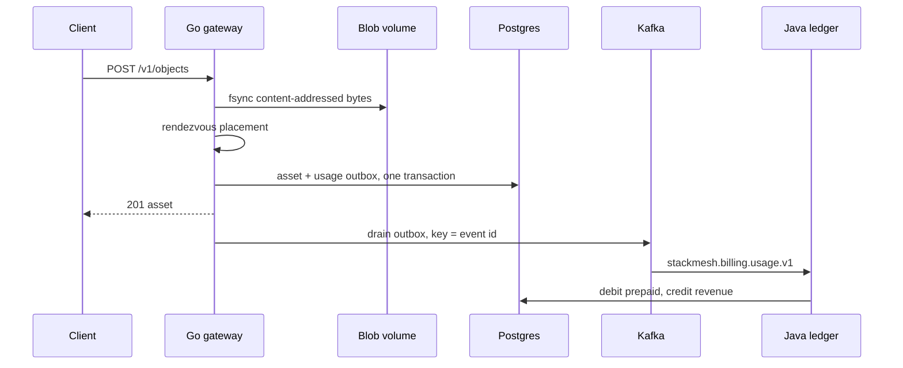

# StackMesh

Distributed media platform. The edge gateway accepts object bytes, places replicas, and emits usage. The billing engine turns that usage into a balanced sub-ledger. The inference grid is the GPU deployment contract for tagging and captioning.



## Layout

```text
distributed-media-platform/
├── .github/workflows/
│   └── deploy-infra.yml                # verify, package, staging gate, production gate
├── go-media-gateway/                   # edge intake and placement
│   ├── cmd/main.go
│   ├── internal/
│   │   ├── domain/                     # placement, mime policy, stable ids
│   │   ├── ports/                      # ingest service, HTTP, Kafka publisher
│   │   └── repository/                 # pgx pool, outbox, content-addressed blobs
│   └── proto/media/v1/gateway.proto
├── java-billing-engine/                # double-entry usage ledger
│   ├── src/main/java/com/stackmesh/
│   │   ├── config/                     # API key filter, Kafka dead-letter policy
│   │   ├── model/                      # account, journal, ledger line
│   │   └── service/                    # locked postings and the usage listener
│   ├── pom.xml
│   └── src/main/resources/db/changelog/
├── mlops-inference-grid/
│   ├── serving/triton/                 # tagger model repository
│   ├── serving/vllm_config.json        # INT4 AWQ and GPTQ profiles
│   └── k8s-deployment.yaml             # MIG slice limits, quota, PDB, HPA
├── docker-compose.yml
└── README.md
```

Dockerfiles, unit tests, and the Postgres init script sit next to those packages.

## Rules the code actually enforces

- An object id is `sha256(tenant + "/" + content hash)`. The same bytes from the same tenant return the original row and do not enqueue a second storage charge.
- The asset row and its outbox row commit together. The drainer publishes after commit and marks the row only after the broker accepts it. A crash in between republishes, and the ledger ignores a repeated `eventId`.
- Storage is priced at 2 micros per KiB, rounded up. Egress is 5 micros per KiB. Inference is 20 micros per token. One micro is one millionth of a dollar.
- A usage posting debits the tenant `PREPAID` liability and credits the platform revenue account for that meter. A grant debits platform `PROMO_EXPENSE` and credits `PREPAID`. The two line amounts are equal, and neither normal balance is allowed to go negative.
- The two accounts in a posting are locked with `SELECT … FOR UPDATE` in tenant-then-code order.
- Unknown meters, unknown accounts, and insufficient prepaid are not retried. Kafka sends those records to `stackmesh.billing.usage.v1.DLT`.
- Triton pods request one `nvidia.com/mig-1g.5gb` slice. The caption pod requests one `nvidia.com/mig-2g.20gb` slice. Requests equal limits, so the pods are Guaranteed. The tagger scales on CPU from 2 to 4 replicas. vLLM arguments are the `int4-awq` profile in `serving/vllm_config.json`.

`demo` starts with 50.000000 USD of prepaid credit. The opening journal is in the Liquibase script, so the trial balance is already balanced before any traffic.

## Run the control plane

Docker Compose starts Postgres, Redpanda (Kafka API), the gateway, and the ledger. It does not start the GPU grid.

```bash
docker compose up --build
```

Gateway: `http://localhost:8080`. Ledger: `http://localhost:8081`. Kafka on the host: `localhost:19092`.

The sandbox database password and the ledger key `sandbox-key` are for this compose file only. Change both before any shared environment. Ledger routes other than health require `X-Stackmesh-Key`.

```bash
curl -sD - -H 'X-Tenant-Id: demo' -H 'Content-Type: video/mp4' \
  --data-binary 'clip' \
  localhost:8080/v1/objects

curl -s -H 'X-Stackmesh-Key: sandbox-key' localhost:8081/v1/ledger/trial
curl -s -H 'X-Stackmesh-Key: sandbox-key' localhost:8081/v1/ledger/accounts/demo
```

Four bytes round up to one KiB, so that upload posts 2 micros. Prepaid falls by 2 and `REV_STORAGE` rises by 2. Poll the trial balance after a short outbox delay (`OUTBOX_INTERVAL`, default 500ms).

Open another tenant with a grant, then upload with `X-Tenant-Id: studio`:

```bash
curl -s -H 'X-Stackmesh-Key: sandbox-key' -H 'Content-Type: application/json' \
  -d '{"eventId":"grant:studio:1","tenantId":"studio","amountMicros":1000000}' \
  localhost:8081/v1/ledger/grants
```

Preview placement without storing bytes:

```bash
curl -s 'localhost:8080/v1/route?hash=<64 hex chars>&bytes=1024&mime=video/mp4&region=us-east-1'
```

Without `DATABASE_URL` and `KAFKA_BROKERS`, `go run ./cmd/main.go` keeps metadata in memory and logs usage. That mode is only for a local process.

## Tests

```bash
cd go-media-gateway && go test ./...
cd java-billing-engine && mvn -B test
```

Gateway tests cover region-biased placement, idempotent ingest, the outbox hold-back when publish fails, and the HTTP status mapping. Ledger tests cover the price table, debit-normal and credit-normal balances, and the overdraft guard.

## Pipeline

`.github/workflows/deploy-infra.yml` has six jobs:

1. `verify-gateway` — `gofmt` and `go test`
2. `verify-billing` — Maven unit tests
3. `verify-manifests` — `docker compose config` and kubeconform
4. `package` — builds both service images
5. `deploy-staging` — GitHub environment `staging`, then `kubectl apply` when `KUBECONFIG_DATA` is set
6. `deploy-production` — runs only after staging, on environment `production`

Protect `staging` and `production` with required reviewers. Until the cluster secret exists, the deploy jobs stop after the approval gate and do not apply anything.

## Inference grid

The tagger image packages the Triton model repository. `model.py` is a boot skeleton: it serves the `IMAGE` / `LABEL` contract and returns `unspecified` until a real model replaces `execute()`.

```bash
docker build -t stackmesh/media-tagger:0.1.0 mlops-inference-grid/serving/triton
kubectl apply -f mlops-inference-grid/k8s-deployment.yaml
```

The caption deployment expects `stackmesh/media-caption-7b` and a node that advertises the MIG resource. The namespace policy is `baseline` because GPU runtimes still need more than a restricted policy allows. Containers drop capabilities, run as uid 1000, and mount writable cache and `/dev/shm` because the root filesystem is read-only.

`serving/vllm_config.json` also carries an `int4-gptq` profile. Switching the deployment to it means changing `--quantization` to `gptq` and pointing `--model` at the GPTQ weights.
